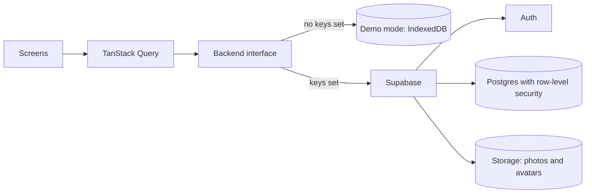

# SHASHIN

One photo a day, only for your friends.

## ABOUT

Shashin is a private photo diary. Each person posts one picture a day, only friends they've
*accepted* can see it, and the *Library* collects every week of photos into something like an album.
No likes, no followers, no public feed.

It works straight away in **demo mode**, with everything stored in your browser, so you can try it
without setting anything up. Connect it to a free Supabase project when you want real accounts and
friends on other phones.

## FEATURES

- One photo per day, using your phone's *local date* (not UTC)
- Friends by username, with requests you accept or decline
- A Today feed of your friends' photos
- A *Library* that groups every week like an album, plus your posting *streak*
- Works offline in *demo mode*, with sample friends to fill the feed
- Installable on a phone's home screen (*PWA*)
- Made for phones first: large buttons, safe-area padding, reduced motion respected

## HOW IT WORKS

All data access goes through one `Backend` interface (`src/lib/backend/types.ts`) with two versions:

- **Demo:** stores accounts and photos in IndexedDB, in your browser
- **Supabase:** uses Postgres, Auth and Storage, with *row-level security* rules so people can only
  see photos from *accepted* friends

The app picks Supabase when its URL and key are set, and *demo mode* otherwise.

## ARCHITECTURE



Screens never talk to a database directly. They use one interface with two versions, so *demo mode* and Supabase behave the same.

## TECH STACK

<p align="center">
  
  
  
  
  
  
  
  
</p>

| Layer | Technology |
|---|---|
| App | React, TypeScript, Vite |
| Styling and motion | Tailwind CSS v4, Motion, React Bits-style components |
| Data and routing | TanStack Query, React Router |
| Backend | Supabase: Postgres, Auth, Storage, Realtime |
| Offline demo | IndexedDB |
| Quality | Vitest, oxlint, Prettier |

## GETTING STARTED

You need [Node.js](https://nodejs.org) 20 or newer.

```bash
git clone https://github.com/Iamshi-vissa/Shashin.git
cd Shashin
npm install
npm run dev
```

Open <http://localhost:5173>. It starts in *demo mode* with sample friends (Aiko, Kenji, Mei and
Ravi). To start over, go to **Friends → your avatar → Reset demo data**.

**On your phone:** connect to the same Wi-Fi and open the `Network:` address that `npm run dev`
prints, for example `http://192.168.1.23:5173`. Use **Add to Home Screen** for an app-like feel.

### USING SUPABASE

1. Create a free project at [supabase.com](https://supabase.com).
2. Open **SQL Editor**, paste the contents of
   [`supabase/migrations/20261108000000_init.sql`](supabase/migrations/20261108000000_init.sql)
   and run it. This creates the tables, security rules, storage buckets and Realtime.
3. For quick testing, turn off **Authentication → Sign In / Providers → Email → Confirm email**.
   Turn it back on before real people join.
4. Copy `.env.example` to `.env` and fill in the **Project URL** and the **publishable (anon) key**
   from **Project Settings → API**. Never put the `service_role` key in the app.
5. Restart `npm run dev`.

### DEPLOYING TO VERCEL

1. Import the repo at [vercel.com/new](https://vercel.com/new). The Vite settings are detected
   automatically, and `vercel.json` already handles page routes.
2. Add `VITE_SUPABASE_URL` and `VITE_SUPABASE_PUBLISHABLE_KEY` as environment variables.
3. In Supabase, under **Authentication → URL Configuration**, set the Site URL to your Vercel
   address and add it to the Redirect URLs.

## COMMANDS

| Command | What it does |
|---|---|
| `npm run dev` | Start the app, reachable from your phone on the same network |
| `npm test` | Run the 11 unit tests (dates and streaks) |
| `npm run check` | Lint, type-check, test and build in one go |
| `npm run build` | Production build |

## PROJECT STRUCTURE

```
src/
  screens/        SignIn, Today, Post, Library, Friends, Add by username
  components/     photo viewer, profile sheet, buttons and other pieces
  components/bits/ animated components (BlurText, Aurora, Dock, CountUp and others)
  lib/backend/    the Backend interface, plus the Supabase and demo versions
  lib/dates.ts    local day, week and streak helpers
supabase/migrations/  database schema, security rules and storage policies
```

## NOTES FOR CONTRIBUTORS

- Design direction: dark, warm and minimal, like film photos. Accent `#FFD84D` on `#0E0E10`.
  Design at 390 px wide. Heavy backgrounds only on the sign-in screen.
- Read and write data only through `src/lib`. Both backends must implement every method of the
  `Backend` interface.
- Always use `src/lib/dates.ts` for dates, so a "day" is the phone's local day.
- Every database change is a new file in `supabase/migrations`.
- Run `npm run check` before committing.

## STATUS

Version 1 is complete and works in both demo and Supabase mode. Next up is wrapping it as a native
Android and iOS app with Capacitor.

## LICENSE

MIT. See [LICENSE](LICENSE).
